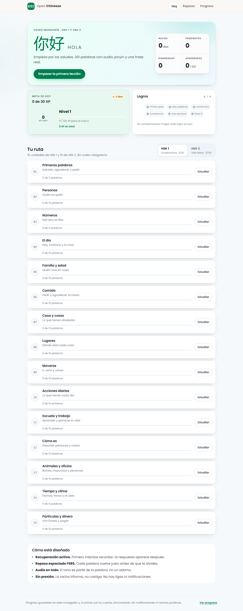

# Open Chinesse

Curso web de chino mandarín para hispanohablantes: **HSK 1 y HSK 2 completos**
(301 palabras), audio en cada tarjeta, repaso espaciado FSRS y práctica de
recuperación real. Progreso local y, si entras con tu cuenta, sincronizado.

**En vivo:** https://open-chinesse.eridu.top



## Qué incluye

|             |                                                                                          |
| ----------- | ---------------------------------------------------------------------------------------- |
| Vocabulario | HSK 1 (151) + HSK 2 (150) en 30 unidades temáticas                                       |
| Por palabra | Hanzi, pinyin con tonos, significado, frase de ejemplo traducida y audio                 |
| Repaso      | FSRS-6 con cuatro calificaciones e intervalo visible                                     |
| Producción  | Las tarjetas maduras piden escribir el pinyin                                            |
| Cuenta      | OAuth2 (Google o GitHub); sin credenciales, modo invitado                                |
| Progreso    | `localStorage` + sincronización con el backend (gana el más reciente)                    |
| Motivación  | XP, niveles, meta diaria, estrellas por unidad y 6 logros; sin ligas ni castigos         |
| Diseño      | Paleta menta/pastel inspirada en HelloChinese, componentes propios y movimiento reducido |
| Stack       | Vite 8 · React 19 · TypeScript 7 · SCSS · Zustand · ts-fsrs 6                            |
| Backend     | Spring Boot 4.1.2 · Java 25 LTS · H2 · Flyway · OAuth2                                   |

## Cómo correr

### Solo el frontend (modo invitado)

```bash
pnpm install
pnpm dev          # http://localhost:5173
```

Sin backend, el progreso vive en el navegador y no hay login. Es la forma más
rápida de ver la app.

### Todo, con backend

```bash
cd backend && mvn spring-boot:run        # :8090
pnpm dev                                 # :5173, proxya /api y /oauth2
```

### Producción

```bash
./deploy.sh
```

Compila el SPA dentro del jar del backend, lo empaqueta y lo publica en
`open-chinesse.eridu.top` (Docker + túnel de Cloudflare propio).

## Investigación abierta

El dossier vive en [investigation/](investigation/README.md): input comprensible, las
1000 palabras más frecuentes (dataset reproducible), herramientas didácticas,
gamificación y un teardown de HelloChinese con propuesta de colaboración.

## Diseño basado en evidencia

Cada decisión viene de literatura revisada en
[`resources/investigation-education/`](resources/investigation-education/):

| Decisión                            | Evidencia                                                            |
| ----------------------------------- | -------------------------------------------------------------------- |
| Recuperación activa                 | Roediger & Karpicke 2006; Rowland 2014 (g = 0.50); Adesope 2017      |
| FSRS en lugar de SM-2               | Benchmark SRS (350M repasos): superioridad 99,6 % frente a Anki SM-2 |
| Frase de ejemplo por palabra        | Krashen 1985; crítica en Liu 2015 y síntesis de Lichtman 2021        |
| Audio y pinyin por tono             | Wang et al. 1999 (+21 %, retenido 6 meses); metaanálisis HVPT 2025   |
| Pinyin tecleado en tarjetas maduras | Guan et al. 2011 (tecleo fortalece forma→sonido)                     |
| Sin rachas punitivas                | ACM L@S 2022 (gamification misuse); Barasch & Silverman 2023         |

## Estructura

```
src/                    SPA
  data/                 301 palabras, 30 unidades (hsk1*.ts, hsk2*.ts)
  srs/                  adaptador FSRS + cola de repaso
  store/                estado, métricas, sesión y sincronización
  lib/                  API, audio, pinyin/tonos, router, quiz
  screens/              Home · Lesson · Review · Stats
  styles/               tokens, mixins y parciales SCSS
backend/                Spring Boot 4.1.2 (Java 25)
  src/main/java/top/eridu/openchinesse/
    auth/               usuarios OAuth2
    config/             seguridad, CSRF, registro de clientes
    progress/           repositorio y servicio de progreso
    web/                API REST
  src/main/resources/db/migration/   Flyway
deploy/                 docker compose del servidor
docs/                   plan, evidencia de despliegue, capturas
resources/              investigación educativa (papers)
investigation/          dossier aplicado por temas + dataset de frecuencia
```

## API

| Método | Ruta                  | Descripción                                           |
| ------ | --------------------- | ----------------------------------------------------- |
| GET    | `/api/auth/providers` | Proveedores configurados (`[]` en modo invitado)      |
| GET    | `/api/csrf`           | Token y nombre de cabecera                            |
| GET    | `/api/me`             | Usuario de la sesión (401 sin sesión)                 |
| GET    | `/api/progress`       | Progreso guardado (404 si es la primera vez)          |
| PUT    | `/api/progress`       | Guarda el progreso; `revision` sube en cada escritura |

El progreso viaja como JSON opaco (el servidor no conoce FSRS) con un límite de
2 MB. En conflicto gana el `updatedAt` más reciente.

## Activar el login

1. Crea credenciales OAuth con redirect
   `https://open-chinesse.eridu.top/login/oauth2/code/google` (o `/github`).
2. Rellena `deploy/.env` (plantilla en `deploy/.env.example`).
3. `sudo docker compose up -d --force-recreate` en el servidor.

Sin credenciales la app funciona igual, sin cuentas.

## Atajos de teclado

| Tecla     | Acción                            |
| --------- | --------------------------------- |
| `Enter`   | Avanzar en la lección             |
| `Espacio` | Revelar la respuesta              |
| `1`–`4`   | Otra vez · Difícil · Bien · Fácil |
| `P`       | Escuchar la palabra               |

## Límites conocidos

- El audio usa las voces `zh-CN` del sistema; sin ellas suena la voz por defecto.
- Los pesos de FSRS son los de fábrica (optimización por usuario pendiente).
- Sin escritura de trazos ni PWA: ver `docs/plan.md`.
- El contenido está escrito a mano; falta revisión de un hablante nativo.

## Licencia

MIT. El vocabulario sigue las listas oficiales HSK 1 y HSK 2.
